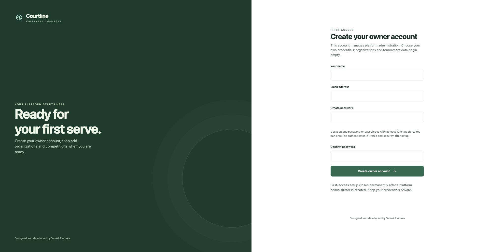
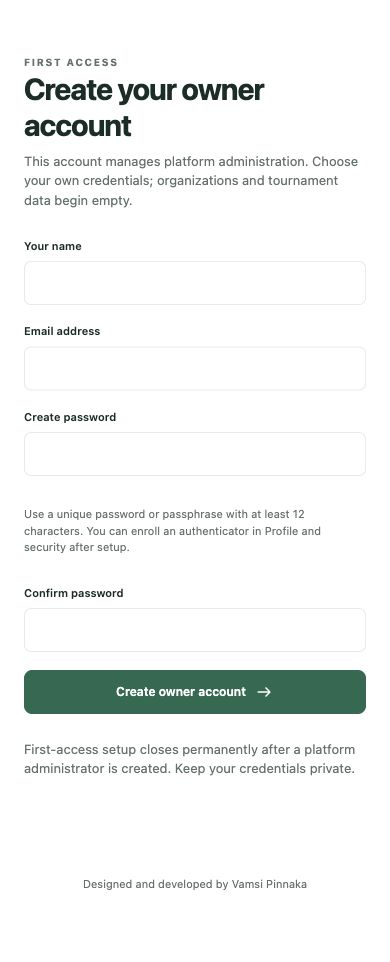

# Volleyball Manager

A self-hosted, mobile browser application for volleyball tournaments and leagues. Organizers manage organization-scoped competitions, referees score individual games through private QR access, and spectators view published events without accounts.

Designed and developed by Vamsi Pinnaka

The application uses Flask, SQLAlchemy, Alembic, PostgreSQL, and modular HTML/CSS/JavaScript. PostgreSQL stores accepted scoring events, projections, court assignments, rules, results, sessions, and audit history. Browser storage holds preferences and clearly marked Pending actions awaiting server acknowledgment.

## Features

- Organization and staff administration with independent memberships, roles, MFA, and tournament scope.
- Tournament divisions, reusable teams and venues, courts, rules, fixtures, leagues, standings, and result approval/correction.
- Game-scoped QR admission, referee scoring, scorer handover, recovery, whistle audio, and automatic screen wake lock where supported.
- Public event pages and presentation displays with live updates and separate display configuration.
- Filtered CSV/XLSX/PDF reports, reviewed CSV imports, durable export jobs, operational status, and recovery tools.

An installation starts with **no application accounts, organizations, tournaments, or saved games**. First access opens signup for the initial platform administrator. Normal startup applies migrations and starts services; it does not seed demonstration records or restore a previous installation. Existing databases keep their records on ordinary restart. To make a fresh installation, use a new, empty database and private storage.

## First access

These screenshots show the real first-run form on an empty local installation, with no account or password entered. See the [screenshot notes](docs/screenshots.md) for scope.

| Desktop | Mobile |
| --- | --- |
|  |  |

## Local development

Use Python 3.12+ (3.14 has been tested), PostgreSQL 18 server/client tools, and an isolated development database. Dependencies are pinned in [requirements.txt](requirements.txt). With `uv` installed, run from the repository root:

```sh
uv venv --python 3.14 .venv
uv pip install --python .venv/bin/python -r requirements.txt
.venv/bin/python scripts/start_local.py
```

The launcher prepares a project-local PostgreSQL cluster, applies migrations, and starts Gunicorn plus the export worker. Open **http://127.0.0.1:5050**. On a fresh database, choose your own name, email, and password on the first-run signup screen. This creates a platform administrator only; organizations and organizer accounts are created afterward in platform administration. There are no published default logins or passwords.

Setup uses origin and CSRF checks, database-backed throttling, and a permanent first-administrator closure. Complete setup before exposing the application to other people. The explicit `bootstrap-admin` CLI remains available for operators who provision the account from a trusted terminal.

The local helper creates a nonowner runtime role, separate migration/test roles, and an operator backup role. Random database/application configuration is stored in ignored `.env` with restricted permissions. The local database listens on loopback port 55433 by default. The cluster and private application files are under ignored `instance/`; do not distribute them. The default PostgreSQL binary directory is `/opt/homebrew/opt/postgresql@18/bin`; set `POSTGRES_BIN` and `POSTGRES_PORT` for another installation. Ctrl+C stops web and worker; the database remains available for a subsequent restart.

To start components individually:

```sh
.venv/bin/python scripts/local_database.py
.venv/bin/alembic upgrade head
.venv/bin/flask --app volleyball run --host 127.0.0.1 --port 5050
```

Start `.venv/bin/flask --app volleyball worker` in a second terminal for exports. `worker --once` processes one batch. Optional synthetic demonstrations must be created explicitly in a disposable database; they are not part of normal application setup or public release files. Configure and migrate a database whose name contains a `_demo` or `_test` segment with `APP_ENV=development` or `test`, then invoke `scripts/prepare_demo.py --email organizer@example.invalid --confirm-isolated-database`. It prompts for your chosen synthetic password, creates two labeled demonstration organizations, and writes no saved credential file. It does not create a platform administrator.

## Supplied PostgreSQL and self-hosting

[.env.example](.env.example) defines the configuration contract. Use a nonowner, nonsuperuser runtime `DATABASE_URL` without BYPASSRLS. Run migrations once per controlled release using the separate `MIGRATION_DATABASE_URL`. Configure independent test connections and private durable file storage. Keep operator backup credentials out of the HTTP runtime.

Production requires a configured HTTPS `PUBLIC_BASE_URL`, secure cookies, strong application secrets, and a separate MFA encryption key. Organizations use [manual staff onboarding](docs/organizer-onboarding.md); email delivery is optional for that flow, but password resets need a configured delivery adapter. Weather and address lookup remain unavailable until their providers and usage terms are configured.

[Deployment guidance](docs/deployment.md) describes optional manual self-host packaging. The public repository does not connect to a preconfigured server or automatically deploy pushes to a VM. Maintain your own host configuration and access keys outside source control.

## Validation

Integration tests require a separate, disposable PostgreSQL database and its nonowner runtime role. They truncate the guarded test database. Never point test URLs at development records you want to preserve or a production database. Migrate the isolated test database, then run tests serially:

```sh
.venv/bin/python - <<'PYTEST'
import os, subprocess
from dotenv import load_dotenv
load_dotenv('.env')
os.environ['MIGRATION_DATABASE_URL'] = os.environ['TEST_DATABASE_URL']
subprocess.run(['.venv/bin/alembic', 'upgrade', 'head'], check=True)
PYTEST
.venv/bin/python -m pytest -q
```

The [release checklist](docs/release-checklist.md) records historical automated, browser, PDF, local load, and isolated recovery evidence alongside open acceptance gates. These measurements use synthetic records and local environments. They do not establish physical-phone support, WCAG conformance, production capacity, licensed-provider availability, or production recovery objectives. Re-run relevant checks for your release.

## Documentation and contribution

- [API](docs/api.md), [schema and RLS](docs/schema.md), and [reporting](docs/reporting.md).
- [Organizer onboarding](docs/organizer-onboarding.md), [venue/provider configuration](docs/weather-adapter.md), and [operations/recovery](docs/operations-runbook.md).
- [Requirements](Requirements/volleyball_v1_codex_requirements.txt) and [release checklist](docs/release-checklist.md).
- [Contributing](CONTRIBUTING.md), [security reporting](SECURITY.md), and [code of conduct](CODE_OF_CONDUCT.md).

Team/player accounts, payments, native clients, additional competition formats, scheduled report delivery, and custom report builders remain outside the implemented scope. Five-minute recovery point and sixty-minute recovery time are proposed production objectives, not service guarantees.

## License

Application code is available under the [MIT License](LICENSE). Bundled Noto Sans fonts use the SIL Open Font License; see [third-party notices](THIRD_PARTY_NOTICES.md).
