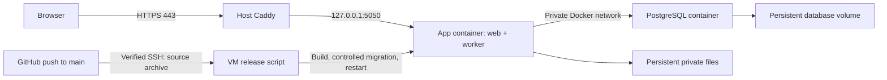

# Demo VM deployment

Designed and developed by Vamsi Pinnaka

This deployment serves **https://volleyball.example.com** from one Linux VM. Caddy runs as a host service. Docker Compose runs exactly two persistent services: `app` and `postgres`. The app container supervises Gunicorn and the durable export worker; migrations and administrator provisioning use short-lived containers.



The private GitHub repository stays private. GitHub Actions checks out its own commit using its read-only token and uploads a source archive over SSH. The VM needs no GitHub personal access token, private Git clone credentials, registry login, or self-hosted Actions runner.

## 1. Server prerequisites

Use a supported Ubuntu or Debian VM with root/sudo access. The supplied host installer supports Ubuntu 22.04/24.04/26.04 and Debian 12/13; it installs Docker Engine, the Compose plugin, and Caddy from their official package repositories. Review available memory/disk against the actual workload before admitting live events; the local load result is not a measurement of this VM.

Create an `A` DNS record for `volleyball.example.com` pointing to the VM's public IPv4 address. Publish an `AAAA` record only if IPv6 reaches this same VM. Permit inbound TCP 80 and 443 in the VM/provider firewall. Permit the SSH port used by deployment. Do not open 5050 or 5432 publicly. Caddy's [automatic HTTPS requirements](https://caddyserver.com/docs/automatic-https) include correct public DNS and reachable challenge ports.

Keep an existing administration session open while changing infrastructure. The installer preserves existing Caddy sites and refuses concrete port/package conflicts that need operator review. It does not replace firewall policy or SSH access settings.

## 2. Initial host setup

Get a reviewed copy of this project's committed deployment files onto the VM through your existing administrator connection. Run commands from that copy's project root. Never copy local `.env`, `instance/postgres`, passwords, backups, or local demo accounts to the VM.

On your Mac, generate a dedicated Actions deployment key outside the Git repository:

```sh
ssh-keygen -t ed25519 -N '' -f ~/.ssh/volleyball-demo-actions -C volleyball-demo-actions
```

Copy only `~/.ssh/volleyball-demo-actions.pub` to the VM using the existing administration account. Keep the private key on your Mac until it is saved as a GitHub Actions secret. On the VM:

```sh
sudo bash deploy/install-host.sh --deploy-key /path/to/volleyball-demo-actions.pub
sudo bash deploy/configure.sh
```

`configure.sh` creates unique random database/application/MFA credentials without printing them. Rerunning it preserves a complete existing configuration and refuses a partial bundle. Its files are root-owned mode 0600 under root-only `/opt/volleyball-manager/config`:

| File | Purpose |
| --- | --- |
| `runtime.env` | Production-mode application configuration and nonowner `volleyball_app` database credentials |
| `operator.env` | Migration owner and operator backup credentials, only for one-shot commands |
| `postgres.env` | PostgreSQL initialization/bootstrap and separate role passwords |
| `release.env` | The exact application image selected by a successful release |

The host creates `/opt/volleyball-manager/data/instance` owned by container UID/GID 10001, with mode 0700. PostgreSQL uses the named volume `volleyball-manager-postgres-data`. Neither is inside the source release directories. PostgreSQL 18's [official image storage layout](https://hub.docker.com/_/postgres) mounts its data volume at `/var/lib/postgresql`.

The dedicated `volleyball-deploy` account is not in the Docker group and cannot read private configuration. Its public key permits only the installed archive receiver through a forced command and a specific sudo rule. The receiver accepts exactly a commit SHA and archive SHA-256, rejects unsafe paths/links/special files, checks source upload limits, and extracts root-owned releases. Because it builds and executes code approved for deployment, this key and write access to `main` are privileged application publishing capabilities.

## 3. Configure GitHub Actions

In [this repository's Actions secrets](https://github.com/OWNER/REPOSITORY/settings/secrets/actions), add:

| Secret | Value |
| --- | --- |
| `DEPLOY_HOST` | The VM's public IPv4 address or SSH hostname |
| `DEPLOY_USER` | `volleyball-deploy` |
| `DEPLOY_PORT` | Optional SSH port; empty uses 22 |
| `DEPLOY_SSH_KEY` | Complete private key from `~/.ssh/volleyball-demo-actions`, including header/footer |
| `DEPLOY_KNOWN_HOSTS` | Verified known-hosts entry for the exact SSH address and port |

Obtain the server's public host key through the already trusted administration session or provider console:

```sh
sudo cat /etc/ssh/ssh_host_ed25519_key.pub
sudo ssh-keygen -lf /etc/ssh/ssh_host_ed25519_key.pub
```

For port 22, the `DEPLOY_KNOWN_HOSTS` secret has this format, substituting the actual address and public key:

```text
VM_PUBLIC_IP ssh-ed25519 ACTUAL_SERVER_PUBLIC_HOST_KEY
```

For another port, use `[VM_PUBLIC_IP]:PORT` as the first field. Match the exact `DEPLOY_HOST` value. The public host key is not the deployment user's public key. Verify the fingerprint out of band; the workflow deliberately requires [strict SSH host verification](https://man.openbsd.org/ssh_config#StrictHostKeyChecking) and never trusts an unchecked `ssh-keyscan` result. A host rebuild/key change must be reviewed before updating this secret.

The workflow labels its deployment environment `demo`. If your GitHub plan supports environments for private repositories, you may put these same secrets in **Settings → Environments → demo** and allow only `main` there. GitHub Free private repositories can use repository Actions secrets; private environment configuration requires Pro/Team/Enterprise. See [environment availability](https://docs.github.com/en/actions/how-tos/deploy/configure-and-manage-deployments/manage-environments) and [repository secrets](https://docs.github.com/en/actions/how-tos/write-workflows/choose-what-workflows-do/use-secrets).

After the host and secrets are ready, set repository Actions variable **`DEPLOY_ENABLED` = `true`** under **Settings → Secrets and variables → Actions → Variables**. Leave it unset/false while preparing the VM. This gate allows deployment files to be committed without attempting an unconfigured server connection. Restrict repository write access; protect/review changes to `main` and deployment files where your plan supports it.

## 4. First release and administrator

Commit and push the deployment files to `main`, or use **Actions → Deploy Volleyball Manager demo → Run workflow**, selecting `main`. Every enabled push to `main` subsequently deploys that exact commit. Other branches and pull requests do not deploy.

The job serializes releases without canceling a running deployment. It checks out a [pinned official checkout release](https://github.com/actions/checkout/releases/tag/v7.0.1), grants only `contents: read`, and transfers `git archive` output through verified SSH. It builds `volleyball-manager:<full-commit-SHA>` on the VM, starts the private database, stops the old web/worker together, runs Alembic once with migration credentials, starts the new application, and waits for both container health and HTTP readiness before recording success. This single-host deployment has a brief maintenance window; browser actions remain Pending during interrupted connectivity.

The initial database is empty, with no development seed or inherited local logins. Provision the first platform administrator from an interactive VM administrator terminal, substituting your own email:

```sh
sudo docker compose --project-name volleyball-manager \
  --env-file /opt/volleyball-manager/config/release.env \
  -f /opt/volleyball-manager/current/compose.yaml \
  -f /opt/volleyball-manager/current/deploy/compose.operator.yaml \
  run --rm --no-deps app flask --app volleyball bootstrap-admin --email YOUR_ADMIN_EMAIL
```

Enter the password at the hidden prompt, sign in over HTTPS, and enroll MFA. Provision organizations and their initial organizers through platform administration. Never include the operator overlay in a long-running `up` command. The normal app command refuses privileged database credentials.

After first release, verify the external HTTPS page and certificate from outside the VM. Container/loopback readiness does not prove public DNS, provider firewall rules, or certificate issuance; the workflow reports these as a separate host check.

Invitations and password resets remain in deferred delivery until you configure an actual SMTP provider in the VM's `runtime.env`; weather remains disabled until a licensed provider is selected. After a reviewed environment change, recreate only the app service from the operator terminal:

```sh
sudo docker compose --project-name volleyball-manager \
  --env-file /opt/volleyball-manager/config/release.env \
  -f /opt/volleyball-manager/current/compose.yaml \
  up -d --no-deps --force-recreate app
```

## 5. Operations, failed releases, and rollback

Useful operator commands:

```sh
sudo docker compose --project-name volleyball-manager \
  --env-file /opt/volleyball-manager/config/release.env \
  -f /opt/volleyball-manager/current/compose.yaml ps

sudo docker compose --project-name volleyball-manager \
  --env-file /opt/volleyball-manager/config/release.env \
  -f /opt/volleyball-manager/current/compose.yaml logs --tail 100 app

sudo systemctl status caddy --no-pager
sudo journalctl -u caddy --since '-15 minutes' --no-pager
```

Operational liveness/readiness paths are private to the host/container. The receiver, release script, and rollback share deployment locks. Source archives and Docker images are retained per commit; the successful `current` pointer changes only after readiness. The previous successful SHA is recorded in `/opt/volleyball-manager/config/previous-release`. Do not prune the current/previous images or release directories needed for rollback.

An image build failure leaves the old app running. A failed migration or new-app readiness check attempts to restart the previous image and fails the GitHub job. It preserves the PostgreSQL volume, private files, and secrets. It never automatically downgrades migrations or rewinds acknowledged scoring data. A partially applied incompatible migration can prevent the old image from becoming ready; inspect the private migration/app logs and use reviewed forward repair or the isolated database recovery procedure.

Before enabling automatic releases against real data, require a current independently stored recovery package and review each schema change for compatibility with the previous image. An empty first demo database needs no historical-data backup. The release script does not silently create or verify an off-VM recovery destination; keep automatic deployment disabled until your recovery policy is satisfied for the data actually hosted.

For a compatible application rollback, run either:

```sh
sudo bash /opt/volleyball-manager/current/deploy/rollback.sh
# Or choose a retained immutable release explicitly:
sudo bash /opt/volleyball-manager/current/deploy/rollback.sh FULL_40_CHARACTER_COMMIT_SHA
```

Rollback changes application code only. Confirm the retained image supports the current schema before using it. For incompatible database changes, use the [migration and recovery runbook](operations-runbook.md); recovery is an explicit operator operation, not an automated `alembic downgrade` or shared-platform data rewind. Root-owned receiver/SSH wrapper/host-init changes require a reviewed host-install update and are not replaced by uploaded application source.

Docker and Caddy start on VM boot; the two containers use `restart: unless-stopped`. A manually stopped service stays stopped until explicitly started. Existing PostgreSQL service/image/init mounts are preserved during app releases. PostgreSQL major version upgrades and password rotation are separate reviewed operator changes; changing initialization variables does not change passwords in an existing volume.

## 6. Backups and release gates

Persistent volumes protect normal container restarts; they are not backups. Before admitting real organizations or live matches, configure independent encrypted recovery storage, scheduled physical backups plus continuous WAL/PITR, private-file/config recovery, retention, backup failure alerts, and an isolated restore drill. The project already includes these operator scripts and the [recovery runbook](operations-runbook.md); this deployment does not invent an external storage destination or claim unmeasured RPO/RTO. Keep the encryption recovery key separate from VM-only copies.

This repository work adds deployment packaging and operations instructions. It does not establish target-VM capacity, provider delivery, physical device/accessibility acceptance, or disaster recovery measurements. Record host-specific evidence and remaining gates in the [release checklist](release-checklist.md) before treating the demo host as production infrastructure.
