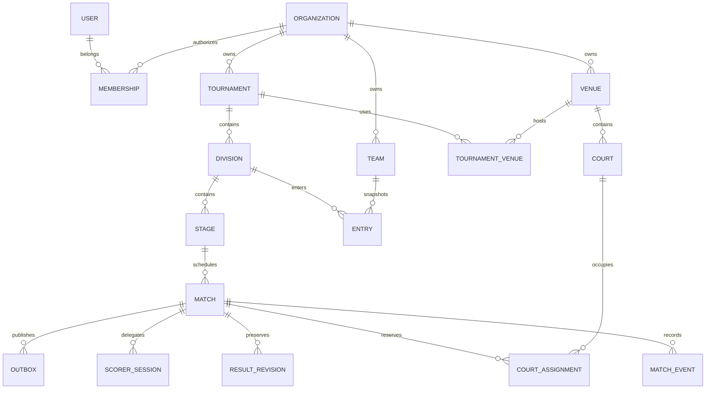

# PostgreSQL schema and isolation

PostgreSQL is the authoritative database. `models.py` and Alembic migrations are the executable schema. UUID primary keys, aware instants and explicit IANA timezones/local dates distinguish event calendars from scoring timing. JSONB holds validated policies, event payloads/projections and layouts; relationships are relational.

Global user identities own authentication sessions and hashed identity tokens. Organization memberships bind a user independently to each organization with status, role and optional tournament IDs. Organization-owned teams, venues/courts and competitions carry organization_id. Entries retain display snapshots and reusable team references. Divisions belong to tournaments; stages belong to division/tournament; matches use composite references to enforce stage/division/tournament and participant consistency. A team rename cannot rewrite its historical entry snapshot.

TournamentVenue records active event/venue associations with composite organization-safe foreign keys and one association per tournament/venue. RuleVersion records tournament/division/stage scope, monotonically increasing scope version, validated rule payload, responsible organizer, reason and creation timestamp. Rule history is unique by scope type/id/version. Historical ranking changes require explicit preview/recalculation and advance the standings source generation; rule-version history and already-started frozen match snapshots are distinct records.

Stage settings identify reviewed repeat/pool/qualification structure. Season playoff stages reference an earlier league/round-robin source in the same division; generated pool playoffs retain their pool source and optional wildcard count. Match source IDs connect winner-dependent bracket games; qualifier placeholders are resolved from finalized source rankings. Cross-pool policies and reasoned manual tie order determine qualifying places. A changed qualifier cannot replace participants in an already-started downstream game; its settings record required adjudication.

Court assignments retain reserved/occupied/released history. Partial unique indexes on unreleased court and match assignments enforce one current occupant/reservation per court and one court per game. Row locks resolve competing claims atomically. Match version/generation plus append-only journal events and result revisions separate accepted actions, scoring ownership and official approvals. `(match_id,sequence)` and `(match_id,client_action_id)` unique constraints prevent duplicate accepted event order/action receipts. Effective rules freeze in the started match snapshot. Current state can be checked against accepted journal/projection history.

Result revisions preserve predecessors/sets/winner/outcome/approver/reason. Outbox events persist change delivery intent in the same match transaction. Audits retain actor type/organizer identity/delegated session/time/reason. Grants and scorer sessions store credential hashes and expiry/revocation, never plaintext admission credentials. Preferences are unique per organization/user/kind/name and stay independent of public tournament display. Jobs persist private import previews and export lifecycle/file metadata. WeatherCache is unique per venue/provider with scoped payload and fetch/expiry times.

## Index purposes

UUID primary/unique indexes support direct authorized object lookups. Organization ID indexes support tenant-scoped list and relationship queries. Membership organization/user uniqueness prevents a second inconsistent membership for the same identity. Division/team uniqueness prevents duplicate event entries. Match `(organization_id,tournament_id,planned_at)` supports schedule/date filtering; `(organization_id,status)` supports live/awaiting-operation lists. Audit `(organization_id,created_at)` supports chronology and bounded report history. The pending-outbox partial index supports undelivered event scans without indexing the entire published history. Grant/scorer/token/session hash unique indexes support unpredictable credential discovery; the scope is established before accessing match data. Court partial indexes enforce concurrency invariants, not merely query speed.

Capture EXPLAIN ANALYZE under representative multi-organization volume before expanding indexes. The development build includes suitable access paths but does not claim measured production query-plan or capacity targets. Report snapshots use a separate repeatable-read PostgreSQL transaction so rows and source generations describe one consistent persisted view.

## RLS and role boundaries

The application checks current user membership, role and tournament scope in every authorized route/job/download. PostgreSQL policies on organization-owned tables are a second boundary: `app.organization_id` is set transaction-locally on each begun session/connection and reset by transaction end. Public slug and hashed delegated-token discovery establish a narrow authorized scope before selecting public/game-safe data. Membership/session lifecycle checks remain mandatory; possession of an object ID is not permission.

Use a nonowner runtime role without superuser/BYPASSRLS and a separate migration owner and operator backup role. Run the provided role/bootstrap migration instructions with operator credentials, grant runtime only necessary tables/sequences and confirm policy behavior using that runtime. Using the database owner alone does not prove tenant isolation. A platform administrator can provision organizations and read aggregate operations; it still does not silently receive private customer tournament permissions. Migration and backup operators are separate infrastructure roles, never exposed by the organizer UI.

Archive/restrict referenced identities rather than cascading away competition history. Deleting membership preserves other memberships and audit references. Files stay in private storage with scoped PostgreSQL job metadata; no public path grants file access. Restoring one organization requires a reviewed selective reconciliation from an isolated platform restore, preserving global user identities and all other organizations.

`verify-projections` checks mutable current match state against the last immutable accepted journal snapshot. `rebuild-match --confirm` restores a reviewed projection and audits the operation. This verifies/rebuilds score state from recorded snapshots; full disaster validation also checks event sequence/version uniqueness, rule/result history, court/session ownership, audits, permissions and file references.
